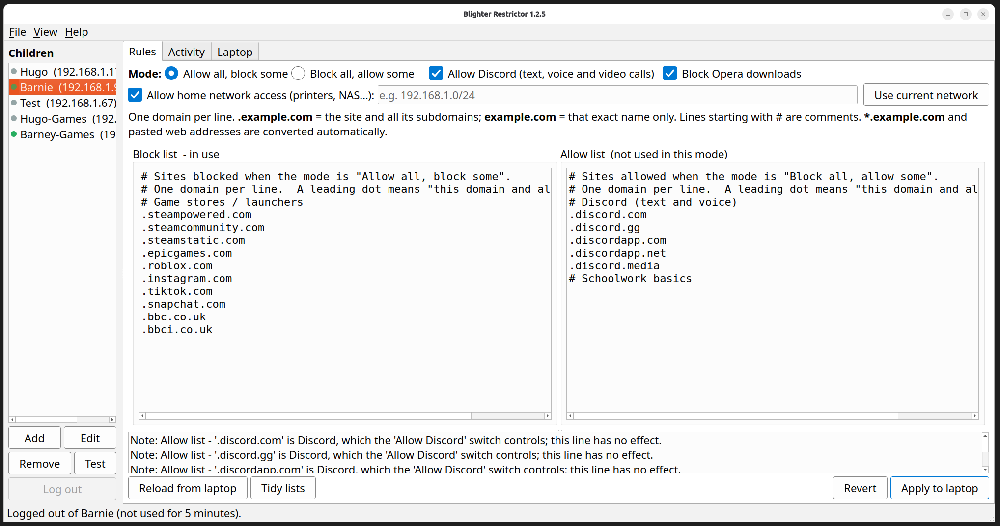

<!--
Blighter Restrictor - README.
Purpose: how the system works, how to install the parent app and the child
component (Ubuntu or Windows PCs), day-to-day use, limits, and how to
build the packages (Linux and Windows).
-->

# Blighter Restrictor 1.2.6

Monitor and restrict your children's web access on their Linux or
Windows 10/11 PCs.
The parent app (Linux or Windows) logs in to each PC over the home network to
change the rules and read the activity log. You can block everything and allow a
few web sites or the oposite, allow all and block a few. You can pause the
restrictions. 



## Support this project

Blighter Restrictor is free to use currently. If it helps your family, donations are
very welcome and help pay for new features and fixes:

* [Ko-fi](https://ko-fi.com/ianp5) - one-off or regular donations, no account needed
* [GitHub Sponsors](https://github.com/sponsors/ianp5uk) - for GitHub users

## IMPORTANT

This application is supplied free of charge for now and you use it at your own risk. It has
been subject to automated testing and I am personally using it. That said please
ensure you have backups of any critical information on your device. You should have
this regardless. It is designed to operate on closed networks such as behind a home
router, as such, for convenience, it uses only password security, no MFA etc.

## Problems, feedback & suggestions

I do not promise to respond to everything but please do report problems, make
suggestions and give feedback. You can report them here:

* [Problems, feedback & suggestions](https://github.com/ianp5uk/blighter-restrictor/issues)

# Installation

#### ** You need to allocate an hour+ to set this up. **

More details further down.

You can install onto the child's PC. It needs an
x86 or x64 Intel or AMD processor. It has not been run or tested on ARM processors.
It might just work on ARM, I have no idea. It has not been tested on tablets.

You do **not** need to change any router settings, reserve addresses or fix MAC
addresses. Setup on the child's PC shows its address once; you type it into the
parent app. If the router later gives the child's PC a different address, the
parent app finds it again by itself: it recognises the PC by its SSH identity
(host key), not by its address or MAC address, and only looks on your home
network.

The overall process is: **first** install the parent app on your own PC (section
1), **then** install the child component on each child's PC while logged on with
Admin / root rights (section 2), then add the child in the parent app with the
address the child setup showed (section 3). It expects both PCs to be on a home
network and able to communicate freely. Privacy & security
was not designed for public networks as this would make it a pain on home networks
secured behind the router's firewall. If your child has Admin rights on their PC,
it is possible they could subvert the restrictions, if they are either highly motivated
or IT smart. If both you're in for a cat and mouse game!

**You will get warnings on Windows during install because this software is not yet
certified.** This requires paying people and having a certificate of origin. This
will be done if there is sufficient interest.

## How it works

```
 Parent PC (Linux / Windows)                Child PC (Linux / Windows)
 ┌──────────────────────────┐   SSH, pw   ┌──────────────────────────────────┐
 │ Blighter Restrictor app  │────────────▶│ blighter account                  │
 │  Rules / Activity / PC   │             │                                   │
 └──────────────────────────┘             │ Squid 127.0.0.1:3128  ── filters  │
                                          │ Firewall: child's account may     │
                                          │  only reach Squid, DNS, UDP voice │
                                          └──────────────────────────────────┘
```

* **Filtering is by domain name.** HTTPS isn't decrypted, so the log shows the
  sites visited (e.g. `www.youtube.com`) but not individual pages.
* **Modes:** *Allow all, block some* uses the Block list. *Block all, allow
  some* uses the Allow list. Both lists are always kept.
* **No bypass by changing proxy settings.** A firewall applied only to the
  child's account rejects all direct internet traffic. The only exceptions are
  DNS and UDP 50000-65535 (Discord voice/video). Steam, other game clients,
  VPNs and so on don't work for that account.
* **>>> Filtering still works when the PC is away from home. Changes and log
  viewing only work on the home network. <<<**
* On **Windows** PCs the firewall covers the **whole PC** (every
  account, including yours), because Windows can't reliably filter outgoing
  traffic per account. See section 1b.
* **Blocked sites show a plain "This site isn't available" page** on plain
  http sites. It doesn't mention Squid, a proxy, filtering or parents, and
  Squid's own headers (`Server`, `Via`, `X-Cache`, `X-Squid-Error`) are
  removed. Secure (https) sites show the browser's own error instead (for
  example "The proxy server is refusing connections"); nothing on the PC
  can change that.
* **The home network is not filtered.** Blighter controls internet access
  only. With *Allow home network access* on (the default), the PC can
  reach printers, NAS drives and other devices on the home network's
  subnet(s) directly, and web pages on them go through Squid without being
  blocked. Setup records the private network (10.x, 172.16-31.x or 192.168.x)
  the PC is on; the Rules tab can change it, including to other ranges
  (with a warning, because websites in a non-private range would bypass the
  filter).
* **Discord** has its own per-child switch, *Allow Discord* (Rules tab). It
  covers Discord's web addresses and, for voice and video calls, outgoing
  UDP 50000-65535. It wins over both lists. Note: while Discord is allowed,
  that UDP range is open to **any** program, so a child who is an
  administrator could run a VPN on a port in that range. For tight control,
  make the child a standard user, or switch Discord off.
* **Opera downloads are blocked** by default (*Block Opera downloads*, Rules
  tab). Opera has a free built-in VPN that can't be switched off, so Squid
  refuses opera.com and Opera's download servers. An Opera that's already
  installed isn't removed. Switch it off per child if you want Opera.
* **VPNs that need a paid subscription** (for example Brave's) are not
  specially blocked. Blighter assumes a parent who pays for one has chosen
  to let the child use it.


## 1. Install the parent app (first)

**Ubuntu:** `sudo apt install ./blighter-restrictor_1.2.6_all.deb`, then start
*Blighter Restrictor* from the app menu (or run `blighter-restrictor`).

**Windows:** run `BlighterRestrictor-Setup-1.2.6.exe` (see "Building for
Windows" below). It isn't signed, so Windows SmartScreen shows a warning:
click *More info → Run anyway*.

On first start it shows a short *Getting started* note (also under *Help*).

## 2a. Set up a child's Linux PC

Do this as an administrator on the child's PC. The child's own account
should ideally **not** be an administrator. The builds targeted Debian
style Linux and have been tested on Ubuntu 26.04

```bash
sudo apt install ./blighter-child_1.2.6_all.deb     # also installs squid, openssh-server, nftables if missing
sudo blighter-setup <child-username>                # e.g. sudo blighter-setup tom
```

The first time, setup asks you to confirm that the parent app is already
installed on your own PC. It then asks you to choose a password for the
**blighter** admin account (you enter it in the parent app). It then:
* saves the existing `/etc/squid/squid.conf` as `squid.conf.pre-blighter-<date>` and installs its own
* allows SSH password login for the `blighter` account only, and switches SSH on
* starts the child-only firewall (`blighter-firewall.service`, started at every boot)
* sets the desktop proxy to 127.0.0.1:3128 and locks it
* makes the Discord launcher (.deb or snap) use the proxy, if Discord is installed

At the end it shows the **address to enter in the parent app** (the PC's
home-network address), with the child's username and the admin login. Keep the
PC switched on and on the home network until the parent app has connected. The
child must log out and back in once.

Later, as a parent on the child's PC:
* `sudo blighter-setup --details` shows the current address again and checks
  and repairs the connection (SSH, the sudo rule, the firewall, Squid). The
  PC's SSH host keys are kept; only missing ones are created.
* `sudo blighter-setup --password` changes the `blighter` password (then enter
  the new one in the parent app with *Edit*).

Notes:
* Discord is allowed by default; switch it off or on in the parent app (Rules
  tab, *Allow Discord*).
  Running setup again keeps the earlier choice.
* Upgrading from an earlier version rewrites the Squid rules with the new settings
  (neutral error page, Discord switch) and keeps the lists. 
* If Squid on the PC already looks set up by something else, setup stops
  before changing anything and asks whether to replace Squid's settings (add
  `--replace-squid` to skip the question).  The old `squid.conf` is saved and put
  back on removal.
* To undo everything: `sudo blighter-setup --remove` (or `sudo apt remove blighter-child`).

## 2b. Set up a child's Windows 10/11 PC

Use 64-bit Windows 10 or 11 (Home or Pro). Sign in to a **parent
administrator account** on the child's PC, not the child's account.

1. Install the parent app on your own PC first (section 1). The installer's
   first page asks you to confirm this.
2. Copy `BlighterChild-Setup-1.2.6.exe` to the child's PC.
3. Double-click the setup exe and follow the directions.
4. It may take a while on some steps, do not give up unless sure it's failed.
5. Pick the child's account from the list, then
   choose a password (10+ characters) for the hidden **blighter**
   administrator account. You enter this password in the parent app.

While it runs, each step shows how long it usually takes and, afterwards, how
long it took. Slow steps print an indicator line every 30 seconds, and
the PC is kept awake. If setup stops part-way, through an error, it offers
to undo what it has done so far (the default is yes). If the PC is switched
off part-way, running setup again offers to finish or undo, and the parent
app's PC tab warns that setup didn't finish. To update a PC from an earlier
version, run the new setup over the top. Its saved "before" state is kept.

Setup then:
* **before changing anything else**, creates a Windows restore point called
  *Before Blighter Restrictor*. It switches on System Protection for C: if it's
  off. It also saves the PC's current settings in
  `C:\ProgramData\BlighterChild\state\pre-install.json`: firewall defaults,
  browser proxy policies, the child's own proxy setting, and whether OpenSSH,
  Squid and the `blighter` account already existed.
* downloads and installs **Squid for Windows** (Diladele, Squid 7.8) if it's
  missing, and locks `C:\Squid` so only administrators can change it.
  Folders made at the root of C: are otherwise changeable by every signed-in
  user, which would let a child edit the filter.
* copies the helper, with its own private copy of Python, to
  `C:\ProgramData\BlighterChild` (locked the same way)
* creates the hidden `blighter` administrator account and switches on
  Windows' own **OpenSSH Server**
* saves the existing `squid.conf` as `squid.conf.pre-blighter-<date>` and
  installs its own. Squid for Windows can't read Windows' DNS settings, so
  it uses 1.1.1.1 and 8.8.8.8. To use others, run
  `blighter-setup.ps1 -DnsServers "9.9.9.9 149.112.112.112"`.
* sets up the **whole-PC firewall**. Outgoing traffic is blocked by
  default. Only Squid, Windows' own services (DNS, DHCP, time, Windows
  Update, Defender, network check, Microsoft account sign-in, Edge updates),
  ping, UDP 50000-65535 (Discord voice) and the home network (printers,
  NAS...) can go out. All other "allow
  outgoing" rules (Store apps, Xbox, games) are switched off, and their names
  are recorded so removal can switch them back on.
* allows incoming SSH only from the local network or the recorded home
  network (even with home network access off), and only while Windows
  calls the network **Private**. If the home Wi-Fi is set to *Public*, setup
  offers to change it.
* points the child's proxy setting, and the Edge, Chrome, Brave, Vivaldi and
  Firefox proxy
  policies, at Squid (127.0.0.1:3128), and greys out Windows' proxy page
* adds a scheduled task, **Blighter Restrictor\Enforce**. As SYSTEM, at start-up,
  at every log-on and every 10 minutes, it repairs the firewall and proxy
  settings and restarts Squid or SSH if they've stopped. A second task starts
  a new Squid log each night (14 old logs are kept).

**Warning - children who are administrators.** On many family PCs the child's
account is an administrator, often because it was the first or only account.
Setup and the parent app both warn about this. An administrator can switch
off the firewall, stop Squid, delete the task or uninstall everything. The
filter still works, and the parent app shows what's in force, but nothing on
the PC can stop an administrator who goes looking. To fix it, create (or
keep) a separate parent administrator account, sign in to it, then in
*Settings → Accounts → Other users* change the child's account to *Standard
user*.

Notes for Windows:
* If the parent app can't connect (it times out) although the PC is on
  and on the home Wi-Fi, turn the PC's Wi-Fi off and on, then try again.
  Windows occasionally works out its "local network" wrongly after a cold
  start; since 1.2.4 SSH is also allowed from the recorded home network, so
  this should be rare.
* Discord (desktop app) uses Windows' proxy setting for text. Voice and video
  use the UDP exception. Both follow the *Allow Discord* switch in the
  parent app's Rules tab (setup asks for the starting value; `-NoVoice`
  blocks it without asking).
* Store apps (Microsoft Store, Xbox, Minecraft from the Store, Mail) are
  usually **offline**. Windows doesn't let them use a proxy on the same
  PC, and their firewall rules are switched off. That also stops the child
  installing Store apps.
* Office, Chrome and other programs that update themselves through their own
  background service can't update while the filter is on. Windows Update,
  Defender and Edge updates still work.
* Browsers show "managed by your organisation". That's the proxy policy.
* The Finished page shows the **address to enter in the parent app**, the
  child's username and the admin login. Setup adds **no Start menu or desktop
  shortcuts**, so nothing catches the child's eye (the Start menu entries of
  1.2.5 are removed on update). The parent's tools are in
  `C:\ProgramData\BlighterChild`.
* **Blighter-Details.cmd** - to open it press *Windows key + R* and type
  `C:\ProgramData\BlighterChild\Blighter-Details.cmd`. It shows the
  current address for the parent app, can check and repair the connection
  (OpenSSH, Squid, the SSH firewall rule, the network type) and change the
  `blighter` password. The PC's SSH identity (host keys) is never replaced.
* **Pause Blighter Child.cmd** (in `C:\ProgramData\BlighterChild`) switches
  Blighter **completely** off without uninstalling, for troubleshooting. The
  firewall, browser policies and the child's proxy go back to how they were
  before setup, and the self-repair task is switched off, so **no activity is
  recorded** while it is off. The parent app can still connect; its PC tab
  says Blighter is switched off on the PC, and its *Resume filtering* switches
  it back on (as does **Resume Blighter Child.cmd**). This is different from
  the parent app's *Pause filtering*, which keeps recording.
* **Remove Blighter Child.cmd** (from the zip or from
  `C:\ProgramData\BlighterChild`) puts the PC back as it was before setup:
  * firewall defaults, the switched-off rules, browser policies and the child's
    proxy setting are restored from the saved record
  * networks that setup marked Private go back to Public
  * anything setup added is removed: it deletes the `blighter` account and its
    profile, stops, disables and uninstalls OpenSSH Server, uninstalls Squid,
    and deletes `C:\ProgramData\BlighterChild`. It asks before each; the
    default answer is yes. Anything that was there before setup is left as it
    was.
  * If anything still behaves differently, use System Restore and pick
    *Before Blighter Restrictor*.
* Emergency fix if the scripts are missing. In an administrator PowerShell, run
  `Get-ScheduledTask -TaskPath "\Blighter Restrictor\" | Unregister-ScheduledTask -Confirm:$false`
  then `Set-NetFirewallProfile -All -DefaultOutboundAction NotConfigured`.
  This restores internet straight away.

## 3. Using the app

* **Add** a child: name, the PC address shown at the end of the child setup,
  the child's username (as given to the setup), admin login `blighter` and its
  password. The app remembers the PC's SSH identity the first time it
  connects. Each PC can be listed only once; a PC already listed twice is
  pointed out when the app starts, so you can remove the extra entry.
  *Test connection*
  checks it, says whether the PC is Ubuntu or Windows (it's recognised
  automatically), and warns if the child is an administrator. Passwords are kept in the system keyring (GNOME Keyring /
  Windows Credential Manager).
* **Rules tab:** pick the mode and edit the lists, one domain per line:
  * `.example.com` – the site **and all subdomains** (normal choice)
  * `example.com` – that exact name only
  * `# text` – a comment
  * `*.example.com` and pasted web addresses are converted automatically.
    Duplicates, and entries already covered by a `.domain` entry, are removed.
  * **Allow Discord** (next to the mode) switches Discord on or off for that
    child, whatever the lists say. Discord lines typed into a list are
    pointed out, because they have no effect. PCs with a child version
    older than 1.2.2 show the switch greyed out.
  * **Block Opera downloads** (next to Allow Discord, on by default) stops
    Opera being downloaded. PCs older than 1.2.4 show it greyed out.
  * **Apply to PC** sends the lists and the switches. The PC
    checks them with Squid and reloads it. If Squid rejects them, the
    previous rules are restored automatically.
* **Finding PCs again:** if a child's PC is not at its last address (the
  router gave it a new one), the app searches the home network for it - the
  /24 network of its last address and of your own PC, SSH port only - and
  checks each answer against the saved SSH identity before sending any
  password. The new address is saved and the list updated. This happens by
  itself when connecting, and for PCs shown offline (at most once a minute
  each).
* **Reconnect** (under the children list): *Find automatically* searches now;
  or enter the address shown on the child's PC (*Blighter-Details.cmd* on
  Windows, `sudo blighter-setup --details` on Ubuntu) and, if it changed, the
  new password. If the computer at that address has a different identity -
  after reinstalling Blighter on it, or with a new PC - the app says so and
  only remembers the new identity when you confirm it is the right PC. The
  child's name, username and the PC's rules and activity log are not changed.
* **Activity tab:** the PC's Squid log, newest first, with filters (time,
  site, blocked only) and a *Summary by site* view. Activity is **collected
  automatically in the background** (every 10 seconds) for every child the app
  is logged in to - whichever child or tab is shown, and also while filtering
  is paused - until you log out of that child or close the app. Only new log
  lines are fetched each time. *First fetch: last N lines* (100 by default)
  sets how much history is fetched when collection starts; *Load history*
  (with *Include older logs* if wanted) fetches more and adds it without
  duplicates. The tab says when the activity was last updated, or that it is
  out of date if the PC can't be reached (it keeps retrying). **Right-click** a row to add that site, or its
  parent domain, to the Block or Allow list. Then press *Apply to PC* in
  the Rules tab.
  Tip for *Block all, allow some*: sites often need extra domains for images
  and scripts (e.g. `.gstatic.com`, `.cloudfront.net`). Tick *Blocked only*
  to find and allow them.
* **Allow home network access** (Rules tab, under the mode) switches the
  home network on or off for that PC and shows its subnet(s), e.g.
  `192.168.1.0/24 (Home Wi-Fi)`. *Use current network* asks the PC
  which network it's on now. Applied with *Apply to PC*.
* **PC tab:** what is actually in force on the PC, read back from it:
  health checks (system, filtered user, whether the child is an
  administrator, Squid running, firewall active, proxy locked), the generated
  rules, both lists, `squid.conf` and the firewall rules.
  The settings appear straight away; the health checks follow (a few
  seconds; on Windows up to a minute). *Reload Squid* rewrites the generated
  rules and re-reads the configuration on demand.
  **Pause filtering** allows every website on that PC, and **Resume
  filtering** switches the rules back on. While paused the PC tab shows a red
  banner and the children list shows "- PAUSED" in red. **Activity is still
  recorded while paused**: web traffic still has to go through Squid (the
  firewall and proxy settings stay on), Squid just lets everything through.
  This lasts across restarts until Resume. PCs with a child version older
  than 1.2.6 stop recording while paused; the app warns before pausing them.
* While the app waits for a PC, the status bar shows **Working…** with a
  moving bar, and that tab's buttons are greyed out. Windows PCs take a
  few seconds per request; Ubuntu PCs answer almost at once.

* **Logging out:** a child shown in **bold** has an open SSH session to their
  PC. Selecting a child logs in to their PC and starts collecting their
  activity. *Log out* closes it for the selected child (and stops collecting
  their activity), and *File → Log out of all PCs* (Ctrl+L) closes them all.
  Sessions also close whenever the app is closed. There is no automatic
  log-out after idle minutes, as that would stop the activity collection.
* **Text size:** *View → Larger text / Smaller text / Normal text size*
  (Ctrl +, Ctrl −, Ctrl 0), from 80% to 300%. The size is remembered.

Settings are stored in `~/.config/blighter-restrictor/` (Linux) or
`%APPDATA%\BlighterRestrictor\` (Windows). Each PC keeps its own list of
children and passwords, so on a second parent PC add the children again.

## Limits

* A determined child with physical access could get round this using recovery
  mode or a USB boot. Setting a GRUB password and a BIOS/UEFI password closes
  that gap if it's needed later.
* For blocked HTTPS sites the browser shows its own proxy error, not the
  "This site isn't available" page, and that error mentions a proxy. Windows'
  proxy settings also say "managed by your organisation". A curious child
  can therefore still find out that a filter is in place.
* DNS (port 53) stays open for the child's account. That's harmless for web
  filtering, which is done on site names by Squid.
* Windows: a child who is an administrator can undo everything (see 2b).
  Booting from USB or reinstalling Windows gets round it too. A BIOS/UEFI
  password and BitLocker close that gap if needed.
* Windows: the Windows component is checked automatically on GitHub's Windows Server
  machines & my own family's. It won't catch every problem as everyone's environment
  is a little different.

## Licence

Copyright (C) 2026 Ian Packer.

Blighter Restrictor is free software, licensed under the **GNU General Public
License v3.0 or later** (`GPL-3.0-or-later`); the full text is in [LICENSE](LICENSE).
You may use, copy, modify and redistribute it. If you distribute it, or a
modified version, whether free or for a fee, you must do so under the same
licence and make the complete source code available to the people you give it
to. It comes with **no warranty**.

Libraries used: PySide6 / Qt (LGPL-3.0), Paramiko (LGPL-2.1-or-later),
keyring (MIT). The Windows build also bundles their dependencies (e.g.
cryptography, bcrypt, PyNaCl), each under its own licence. Ubuntu child PCs
use Squid (GPL-2.0-or-later) and nftables from Ubuntu. Windows child PCs use
Squid for Windows from Diladele B.V. (GPL, downloaded during setup) and the
Windows child package bundles the python.org embeddable Python (PSF License).

## Files

| Path | Purpose |
|---|---|
| `common/domains.py` | Domain validation and the Discord switch rules, shared by the app and the PC helpers |
| `common/blockpage.py` | The neutral error page and Squid header settings, shared by both PC helpers |
| `common/logtail.py` | Reads the activity log a piece at a time (only new lines), shared by both PC helpers |
| `parent/blighter_parent/` | The GUI app (Qt / PySide6, Paramiko SSH, keyring) |
| `parent/packaging/` | Ubuntu launcher, menu entry and package control file |
| `child/files/usr/sbin/blighter-setup` | One-time PC setup / removal |
| `child/files/usr/sbin/blighter-apply` | The only root command the app may run |
| `child/files/usr/sbin/blighter-firewall` | Child-only nftables firewall |
| `child/files/usr/share/blighter-child/squid.conf` | Managed Squid configuration |
| `child-windows/blighter-setup.ps1` | Windows PC setup / removal |
| `child-windows/blighter-system.ps1` | Windows whole-PC firewall, proxy policies, self-repair task |
| `child-windows/blighter-apply.py` / `.cmd` | Windows helper the app runs over SSH (same commands as Ubuntu's) |
| `child-windows/squid.conf` | Managed Squid configuration for Squid for Windows |
| `child-windows/blighter-details.ps1` | Windows: connection details, repair and password change for a parent |
| `child-windows/*.cmd` | Double-click install / pause / resume / remove / details (Blighter-Details.cmd) |
| `build-windows-child.sh` | Builds the Windows child zip |
| `windows/` | Windows build script, installer definition, icon (parent app) |
| `LICENSE` | GNU General Public License v3.0 |
